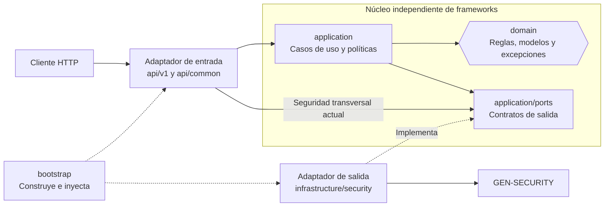
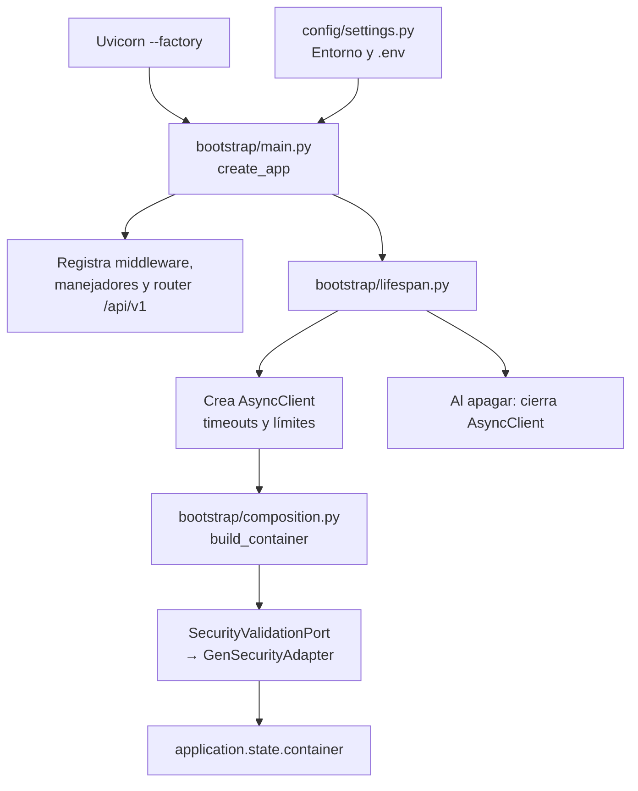
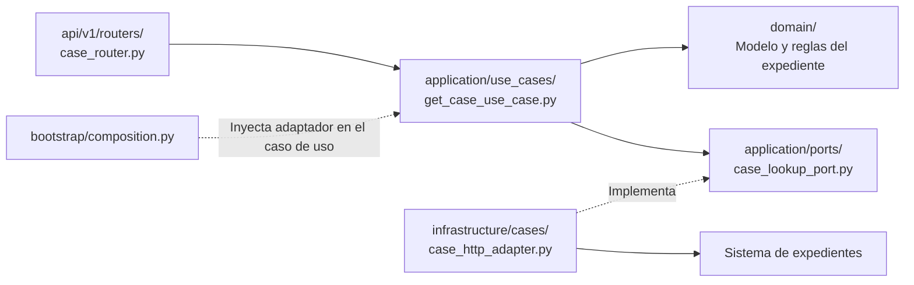

# Arquitectura del arquetipo base

---

El servicio utiliza arquitectura hexagonal: las reglas y los casos de uso no
dependen de cómo llega una petición ni de qué proveedor externo la resuelve.
Los ejemplos de paquetes corresponden a `src/python_ai_service/`; en un proyecto
generado, ese nombre cambia por el paquete del servicio.

## 1. Vista hexagonal



Las flechas hacia los puertos representan **dependencias de código**, no una
llamada del puerto hacia infraestructura. En ejecución se utiliza el adaptador
inyectado por `bootstrap`, pero el consumidor conoce el contrato, no HTTPX.

La base estandariza plataforma, no capacidades IA: no incorpora RAG, bases
vectoriales ni proveedores de modelos. `application/use_cases/` y
`application/policies/` son puntos de extensión; no contienen todavía casos de
negocio implementados. El endpoint Basic actual consume el puerto desde una
dependencia HTTP, sin inventar un caso de uso intermedio.

## 2. Paquetes y responsabilidades

```text
src/python_ai_service/
├── api/
│   ├── common/
│   │   ├── dependencies/       # Headers, seguridad y contexto
│   │   ├── middleware/         # Request ID y access log
│   │   ├── schemas/            # Respuestas compartidas
│   │   └── exception_handlers.py
│   └── v1/
│       ├── api_router.py       # Agrupa las rutas V1
│       └── routers/
│           ├── health_router.py
│           └── auth_router.py
├── application/
│   ├── ports/
│   │   └── security_validation_port.py
│   ├── use_cases/              # Extensión: orquestación de negocio
│   └── policies/               # Extensión: políticas de aplicación
├── domain/
│   ├── request_context.py
│   └── exceptions.py
├── infrastructure/
│   └── security/
│       ├── gen_security_adapter.py
│       ├── gen_security_dto.py
│       └── constants.py
├── bootstrap/
│   ├── main.py                 # Factory create_app
│   ├── lifespan.py             # Apertura/cierre de recursos
│   └── composition.py          # Puertos → adaptadores concretos
└── config/
    ├── settings.py             # Configuración tipada
    └── logging.py
```

| Paquete | Responsabilidad | No colocar aquí |
|---|---|---|
| `api/` | Contratos HTTP, validación de entrada y traducción de errores. | Reglas de negocio o llamadas directas a proveedores. |
| `application/` | Orquestación, políticas y contratos necesarios para los flujos. | FastAPI, HTTPX, Pydantic settings o SDKs de proveedores. |
| `domain/` | Reglas/modelos independientes, contexto y excepciones controladas. | Configuración de entorno, transporte HTTP o persistencia concreta. |
| `infrastructure/` | Implementación de puertos y traducción del contrato externo. | Decisiones de negocio propias del dominio. |
| `bootstrap/` | Construcción de la aplicación e inyección de implementaciones. | Lógica de negocio. |
| `config/` | Lectura del entorno y configuración técnica. | Contratos HTTP de negocio. |

Los esquemas HTTP y los DTO del proveedor tienen responsabilidades distintas:
`api/*/schemas/` describe la interfaz del servicio; `gen_security_dto.py` describe
la respuesta del tercero. No reutilizar el DTO externo como modelo de dominio.

## 3. Arranque y composición



El cliente HTTP se comparte durante la vida de la aplicación: no se crea uno por
petición. Las dependencias de seguridad obtienen el puerto desde el contenedor.
Solo el composition root selecciona `GenSecurityAdapter`; un router no debe
construirlo directamente.

## 4. Flujo actual: autenticación Basic contra GEN-SECURITY

Ejemplo: `GET /api/v1/auth/basic/health`, con `OriginId`, `SubOriginId` y
`Authorization: Basic ...`.

- La ruta del tercero es configurable mediante `GEN_SECURITY_BASIC_AUTH_PATH`;
  el gráfico muestra el valor predeterminado.
- La comprobación local de sintaxis Basic **no autentica** al usuario. La decisión
  la toma GEN-SECURITY: únicamente HTTP exitoso y `returnCode == "000"` permiten acceso.
- Credenciales ausentes o malformadas pueden rechazarse antes de llamar al tercero.
- La validación JWT utiliza el mismo puerto y otro método: envía el token a
  GEN-SECURITY, sin interpretar sus claims localmente.
- Los endpoints públicos `/api/v1/health/live` y `/api/v1/health/ready` no ejecutan
  este flujo ni comprueban disponibilidad de GEN-SECURITY.

Código de referencia: [dependencias de seguridad](../src/python_ai_service/api/common/dependencies/security_dependency.py),
[puerto](../src/python_ai_service/application/ports/security_validation_port.py),
[adaptador](../src/python_ai_service/infrastructure/security/gen_security_adapter.py)
y [composición](../src/python_ai_service/bootstrap/composition.py).

## 5. Incorporar una capacidad nueva

Ejemplo **conceptual**, no implementado en esta base: consultar un expediente en
un sistema externo.



1. **Contrato:** definir entrada, salida, errores y autenticación del endpoint en
   `api/v1/`; agrupar esquemas cohesivos en `*_schemas.py`.
2. **Dominio:** modelar únicamente las reglas que necesita la capacidad, sin
   conocer FastAPI ni el formato de respuesta del tercero.
3. **Aplicación:** crear el caso de uso y, si necesita una integración, un puerto
   con el contrato mínimo. Si no hay integración, no crear un puerto artificial.
4. **Infraestructura:** implementar el puerto, configurar timeouts y traducir
   respuestas/errores externos a resultados o excepciones controladas.
5. **Composición:** construir el adaptador e inyectarlo en el caso de uso; exponer
   este último a la capa HTTP sin importar infraestructura desde el router.
6. **Pruebas:** probar dominio y caso de uso sin red, adaptador con transporte
   simulado y endpoint con dependencias sustituidas. Cubrir éxito y fallos.
7. **Cierre:** actualizar la documentación y ejecutar el flujo completo desde la raíz:

   ```powershell
   uv run --locked --env-file .env python  scripts/check.py
   ```

No agregar capas vacías por cumplir el diagrama ni incorporar proveedores IA que
la capacidad no requiera. No agregar bypass de autenticación para pruebas locales.

## 6. Versionamiento y límites

- `api/common/`: middleware, dependencias y contratos realmente compartidos.
- `api/v1/`: contratos de negocio V1; no significa versión de implementación.
- `api/v2/`: crear solo ante un contrato externo incompatible; V1 puede convivir
  durante una migración.
- `tools/archetype_cli/` y `scripts/build_archetype.py`: distribución/generación,
  no forman parte del flujo HTTP del servicio.

Los diagramas usan Mermaid; visualizarlos en un visor Markdown con ese soporte.
El árbol de paquetes permanece legible incluso sin renderizado.

Documentación relacionada: [guía del developer](../README.md),
[preparación TI_EDO](NEXUS_DEVOPS.md)
